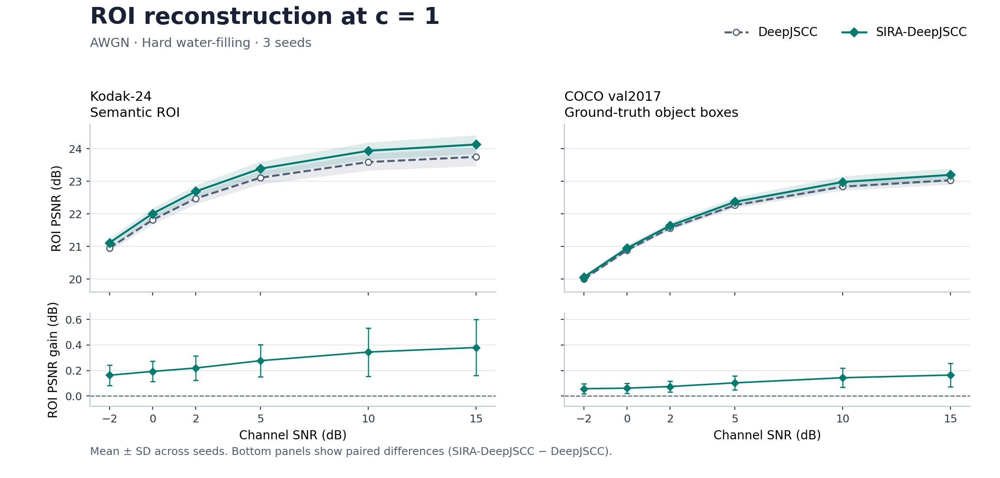
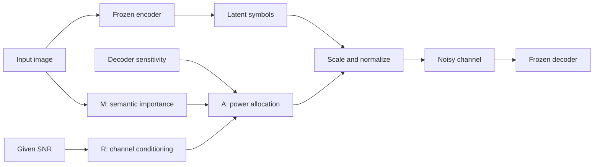

# SIRA-DeepJSCC

This repository compares **DeepJSCC**, a PyTorch CNN baseline based on the
[original DeepJSCC approach](https://arxiv.org/abs/1809.01733), with
**SIRA-DeepJSCC**, a two-stage framework for semantic-aware image transmission.

| Model | Training and transmission |
|---|---|
| **DeepJSCC** | Train the encoder and decoder end to end with mean squared error. |
| **SIRA-DeepJSCC** | Train the backbone with DINOv2-weighted reconstruction, then freeze the encoder and decoder and train a lightweight transmit power adapter. |

## Main Result



With one latent channel (`c=1`) under AWGN and hard water-filling,
SIRA-DeepJSCC has higher mean ROI PSNR than DeepJSCC on Kodak-24 semantic
regions and COCO val2017 object regions at all six evaluated SNRs. The curves
and paired differences show mean ± standard deviation across seeds 42–44.

[Per-seed data](results/sira_main_roi_c1.csv) · [Plotting script](scripts/plot_main_roi.py)

## How SIRA-DeepJSCC Works

SIRA-DeepJSCC trains the encoder and decoder to preserve semantically important
regions, then learns how to allocate transmit power across the latent symbols
produced by that frozen backbone.

### 1. Train a semantic backbone

A frozen DINOv2 ViT-S/14 scores each image patch by the cosine similarity of its
feature to the global image token. The scores are resized and normalized to
form a spatial importance map. Backbone training uses ordinary MSE plus a
second reconstruction term weighted by this map. The weighted term gives more
influence to reconstruction errors in important regions.

### 2. Freeze the backbone and train the power adapter

The encoder and decoder are frozen during this stage. Training updates about
500,000 adapter parameters. The transmitter then uses the following pipeline:



- **Semantic importance (M).** A lightweight multiscale CNN learns to predict
  the DINOv2 importance map using an L1 supervision term. It produces
  importance scores at the latent resolution. The transmitter runs this CNN
  at inference time, so DINOv2 is only needed for training the model.
- **Decoder sensitivity and symbol risk.** During adapter training, the
  frozen decoder reconstructs the image from clean latents. The magnitude of
  the gradient of the reconstruction MSE with respect to each latent symbol
  gives a sensitivity score. Inference uses an exponential moving average
  accumulated during training. Multiplying this score by semantic importance
  and normalizing the product gives the per-symbol risk $s_i$.
- **Channel conditioning (R).** The transmitter receives the SNR as an input.
  R converts it from dB to linear SNR $\gamma$ for water-filling, and a small
  MLP produces a channel embedding and a temperature. The embedding conditions
  the convolutional correction, and the temperature adjusts the concentration
  of the risk scores entering that correction.
- **Power allocation (A).** The hard mode uses a KKT water-filling prior with
  per-symbol weight $[\sqrt{s_i/\gamma}/\mu - 1/\gamma]_+$, where $\mu$ is
  found by bisection to meet the power budget. A small CNN predicts a second
  allocation, and a learned gate mixes it with the prior. The optional soft
  mode blends the prior with a square-root-of-risk allocation, with more
  weight on that term at lower SNR. The main result uses hard water-filling.
- **Transmit power normalization.** The adapter normalizes the allocation
  weights and scales each latent amplitude by the square root of its weight.
  It then normalizes the resulting signal per image to unit average power
  before sending it through the channel.

See the [model implementation](sira/models.py) and [training loop](scripts/train.py).

## Quick Start

### 1. Install

```bash
git clone https://github.com/vale817/SIRA-DeepJSCC.git
cd SIRA-DeepJSCC

python -m venv .venv
source .venv/bin/activate
pip install -r requirements.txt
```

CUDA is strongly recommended for training. Evaluation and visualization can run
on CPU, but will be slower.

Run the data-free structural test:

```bash
python -m scripts.smoke_test
```

### 2. Prepare Data

Expected layout:

```text
data/
  DIV2K/
    DIV2K_train_HR/
    DIV2K_valid_HR/
  kodak/
    kodim01.png ... kodim24.png
  coco/
    val2017/
    annotations/
      instances_val2017.json
```

`setup_and_run.sh` can download DIV2K. Kodak and COCO should be downloaded from
their official sources and placed in the layout above.

### 3. Configure DINOv2

By default, DINOv2 is loaded through `torch.hub`. For an existing local cache:

```bash
export SIRA_DINO_HUB_DIR=/path/to/torch_cache/hub
export SIRA_DINO_SOURCE=local
export SIRA_DINO_REPO_OR_DIR=/path/to/facebookresearch_dinov2_main
```

For a lightweight smoke test without DINOv2:

```bash
export SIRA_IMPORTANCE_MODE=edge
```

The edge mode is a debugging fallback and is not equivalent to the reported
DINOv2 experiments.

## Training and Evaluation

Train DeepJSCC and both stages of SIRA-DeepJSCC in order:

```bash
python -m scripts.train --latent_ch 1 --allocation_mode hard --importance_mode dino
```

Evaluate the two finished models on Kodak-24 and COCO val2017:

```bash
python -m scripts.eval --latent_ch 1 --allocation_mode hard --importance_mode dino --skip_div2k
python -m scripts.eval_coco --latent_ch 1 --allocation_mode hard --coco_root data/coco
```

Run the comparison with all three seeds:

```bash
python -m scripts.run_multiseed \
  --seeds 42 43 44 \
  --latent_ch 1 \
  --allocation_mode hard \
  --importance_mode dino \
  --skip_div2k \
  --eval_coco --coco_root data/coco
```

The AWGN evaluation uses SNRs of −2, 0, 2, 5, 10 and 15 dB. The scripts
report global PSNR, SSIM, LPIPS and ROI PSNR. Kodak-24 ROI comes from DINOv2
importance maps, while COCO val2017 ROI comes from annotated object boxes.
The archived `c=1` DIV2K run evaluated the training split, so it is outside the
main comparison.

- [Experiment notes](docs/PROJECT_STATUS.md)
- [Training details](docs/SIRA_INIT_EXPERIMENT.md)
- [Results and archive](results/README.md)

## Citation

A preprint is in preparation. Citation information will be added when available.
