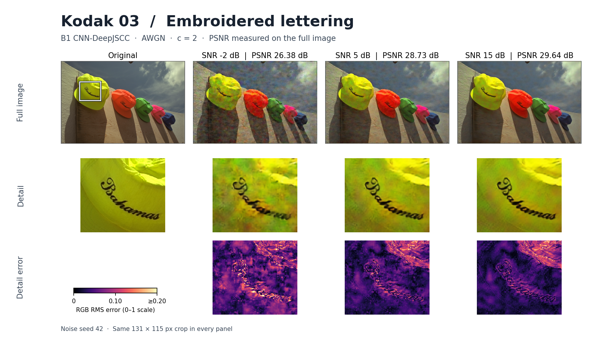

# SIRA: Semantic-Informed Reliability Adaptation for DeepJSCC

SIRA is a transmitter-side power-allocation adapter for pretrained DeepJSCC.
It uses image semantics, decoder sensitivity, and channel SNR to reweight latent
symbols under the same transmit-power budget as the baseline. The adapter is
trained for a pretrained backbone while the encoder and decoder stay frozen.
At deployment, the original receiver decodes the received symbols directly.

[Three-seed results](results/README.md) · [Experiment summary](docs/PROJECT_STATUS.md) · [Kodak reconstruction example](results/qualitative/README.md)

## What SIRA Does

```text
image x -> frozen encoder -> latent z -> spatial power allocation -> channel -> frozen decoder
              |                         ^
              +-> M: semantic map ------|
SNR ----------------> R: reliability ---+-> A: protection adapter
```

- **M, Semantic Prior Mapper:** predicts spatial importance from the input image.
- **R, Channel Reliability Mapper:** maps SNR to a reliability embedding and a
  power-allocation temperature.
- **A, Protection Adapter:** forms a symbol-level risk score from semantic
  importance and decoder sensitivity, then blends a water-filling prior with
  a learned convolutional correction. The scaled symbols are normalized again
  immediately before transmission.

DINOv2 provides semantic supervision during training. Inference uses the learned
semantic mapper and a cached moving average of gradient-based sensitivity.

## Implemented Methods

| Method | Backbone initialization | Trainable components |
|---|---|---|
| `cnn` | trained from scratch with MSE | encoder + decoder |
| `semantic` | trained from scratch with MSE + DINOv2-weighted reconstruction | encoder + decoder |
| `sira_b1_init` | `cnn` checkpoint | M + R + A |
| `sira_b2_init` | `semantic` checkpoint | M + R + A |
| `sira_b2_no_r` | `semantic` checkpoint | M + A |
| `sira` | legacy alias of `sira_b1_init` | M + R + A |

## Main Findings

The table shows the three-seed mean ROI PSNR difference for SIRA-B2 at `c=1`
with hard water-filling, averaged over all six AWGN SNRs. B2 is the
semantic-weighted backbone used to initialize SIRA-B2.

| Dataset | ROI | vs. CNN-DeepJSCC | vs. B2 |
|---|---|---:|---:|
| [Kodak-24](results/experiments/exp3_hard_c1/summary_kodak_awgn_c1.json) | DINOv2 semantic ROI | +0.263 dB | −0.003 dB |
| [COCO val2017](results/experiments/exp3_hard_c1/summary_coco_awgn_c1.json) | Annotated object boxes | +0.101 dB | −0.002 dB |

Low-SNR protection motivated the design. In the `c=2` hard water-filling run,
SIRA-B2's mean ROI PSNR relative to B2 over −2, 0, and 2 dB was +0.026 dB on
[DIV2K](results/experiments/exp1_hard_c2/summary_div2k_awgn_c2.json) and −0.043 dB
on [Kodak-24](results/experiments/exp1_hard_c2/summary_kodak_awgn_c2.json). At
−2 dB on Kodak, full SIRA-B2 also trailed the version without R across all
three seeds. These comparisons show that the effect of explicit SNR conditioning
varies with the dataset and operating point.

### Why inspect local detail?



In a [supplemental B1 run](results/qualitative/README.md), Kodak image 03 reached
28.73 dB full-image PSNR at 5 dB SNR while the embroidered lettering remained
blurred. The figure illustrates local detail loss in the baseline.

## Evaluation

Experiments cover:

- **DIV2K:** in-domain reconstruction. The archived `c=1` run has a [split caveat](docs/EXP3_HARD_WATERFILL_C1.md#23-datasets-and-metrics).
- **Kodak-24:** zero-shot image-domain generalization.
- **COCO val2017:** object-ROI reconstruction using ground-truth bounding boxes.
- **AWGN channels:** SNR sweep `[-2, 0, 2, 5, 10, 15]` dB.
- **Metrics:** PSNR, SSIM, LPIPS, semantic ROI PSNR, and COCO object-ROI PSNR.

The [results index](results/README.md) separates the three-seed experiments
from historical single runs. DeepJSCC evaluation samples channel noise during
inference. The evaluation scripts reset the seed before each method for
matched-noise comparisons.

Training also resets the random state after model and DINOv2 initialization so
adapter variants receive matched data order, sampled SNRs, and channel-noise
sequences.

## Quick Start

### 1. Install

```bash
git clone https://github.com/vale817/SIRA-DeepJSCC.git
cd SIRA-DeepJSCC

python -m venv .venv
source .venv/bin/activate
pip install -r requirements.txt
```

CUDA is strongly recommended for training. Evaluation and visualization can run
on CPU, but will be slower.

Run the data-free structural test:

```bash
python -m scripts.smoke_test
```

### 2. Prepare Data

Expected layout:

```text
data/
  DIV2K/
    DIV2K_train_HR/
    DIV2K_valid_HR/
  kodak/
    kodim01.png ... kodim24.png
  coco/
    val2017/
    annotations/
      instances_val2017.json
```

`setup_and_run.sh` can download DIV2K. Kodak and COCO should be downloaded from
their official sources and placed in the layout above.

### 3. Configure DINOv2

By default, DINOv2 is loaded through `torch.hub`. For an existing local cache:

```bash
export SIRA_DINO_HUB_DIR=/path/to/torch_cache/hub
export SIRA_DINO_SOURCE=local
export SIRA_DINO_REPO_OR_DIR=/path/to/facebookresearch_dinov2_main
```

For a lightweight smoke test without DINOv2:

```bash
export SIRA_IMPORTANCE_MODE=edge
```

The edge mode is a debugging fallback and is not equivalent to the reported
DINOv2 experiments.

## Training

To reproduce the backbone runs from scratch:

```bash
python -m scripts.train --latent_ch 2 --methods cnn semantic
```

With compatible pretrained checkpoints, train the adapters:

```bash
python -m scripts.train \
  --latent_ch 2 \
  --methods sira_b1_init sira_b2_init sira_b2_no_r \
  --allocation_mode hard \
  --batch_size 16
```

Existing checkpoints are skipped unless `--force` is passed. Best-validation
checkpoints are saved as `.pt`; final-epoch checkpoints use `_final.pt`.
`--allocation_mode hard` is the default KKT water-filling method. Use
`--allocation_mode soft` for the low-SNR stabilized sqrt-risk blend. Training
and evaluation must use the same allocation mode.

Multi-seed validation trains and evaluates each seed in its own checkpoint and
result directory, then writes mean/std summaries:

```bash
python -m scripts.run_multiseed \
  --seeds 42 43 44 \
  --latent_ch 2 \
  --methods cnn semantic sira_b1_init sira_b2_init sira_b2_no_r \
  --allocation_mode hard \
  --importance_mode dino
```

For a quick wiring check before the full run, use `--importance_mode edge`,
small epochs, and `--dry_run` first.

## Evaluation and Analysis

DIV2K and Kodak:

```bash
python -m scripts.eval \
  --latent_ch 2 \
  --methods cnn semantic sira_b1_init sira_b2_init sira_b2_no_r \
  --result_dir results/run_c2
```

COCO object ROI:

```bash
python -m scripts.eval_coco \
  --coco_root data/coco \
  --latent_ch 2 \
  --methods cnn semantic sira_b1_init sira_b2_init sira_b2_no_r \
  --result_dir results/run_c2
```

Low-SNR summary:

```bash
python -m scripts.plot_low_snr --latent_ch 2 --result_dir results/run_c2
```

Power-map visualization:

```bash
python -m scripts.visualize_power_map \
  --latent_ch 2 \
  --method sira_b2_init \
  --dataset kodak \
  --index 3 \
  --snrs -2 5 15 \
  --out results/run_c2/power_map_sira_b2.png
```

R-module sensitivity:

```bash
python -m scripts.analyze_r_sensitivity \
  --latent_ch 2 \
  --dataset kodak \
  --methods sira_b2_init sira_b2_no_r \
  --result_dir results/run_c2
```

## Repository Map

```text
SIRA-DeepJSCC/
  sira/       # core models, datasets, and configuration
  scripts/    # training, evaluation, plotting, and analysis entry points
  docs/       # experiment definitions, findings, and release notes
  results/    # representative JSON, tables, and figures
```

| Path | Purpose |
|---|---|
| `sira/models.py` | DeepJSCC, DINOv2 importance, M/R/A, channels, and losses |
| `sira/datasets.py` | DIV2K and Kodak data loaders |
| `sira/config.py` | experiment defaults and paths |
| `scripts/train.py` | backbone and adapter training |
| `scripts/eval.py` | DIV2K/Kodak reconstruction evaluation |
| `scripts/eval_coco.py` | COCO object-ROI evaluation |
| `scripts/plot_low_snr.py` | publication-style low-SNR tables and figures |
| `scripts/visualize_power_map.py` | reconstruction, power-map, and error visualization |
| `scripts/analyze_r_sensitivity.py` | quantitative SNR-to-power-map analysis |
| `scripts/smoke_test.py` | data-free structural check for every model variant |
| `docs/` | experiment definitions, findings, and release notes |

More detailed experiment notes are in
[docs/PROJECT_STATUS.md](docs/PROJECT_STATUS.md),
[docs/EXP3_HARD_WATERFILL_C1.md](docs/EXP3_HARD_WATERFILL_C1.md),
[docs/SIRA_INIT_EXPERIMENT.md](docs/SIRA_INIT_EXPERIMENT.md), and
[docs/SIRA_NO_R_ABLATION.md](docs/SIRA_NO_R_ABLATION.md).

## Limitations

- B1 and B2 are two sets of weights for the same CNN architecture. Each adapter
  is trained against its corresponding backbone.
- The independent contribution of decoder sensitivity remains open. A matched
  comparison of semantic importance alone, sensitivity alone, and their product
  would isolate the input to the risk score.
- The results report variability across three seeds. End-device latency and
  memory overhead remain unmeasured.

## Citation

A preprint is in preparation. Citation information will be added when it is
available.
