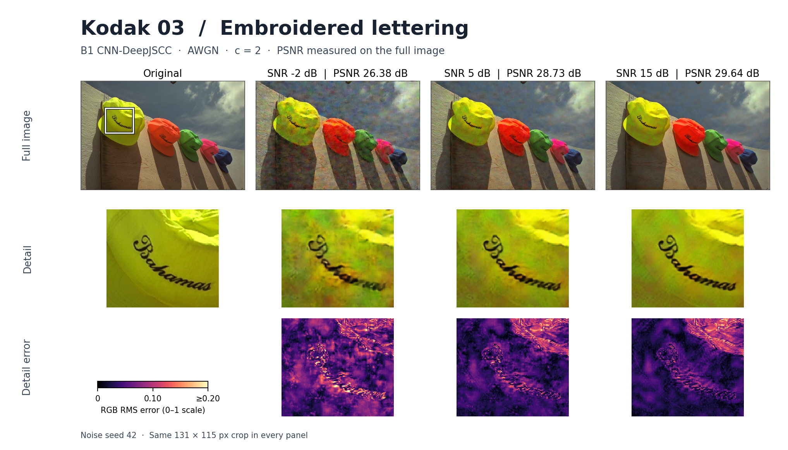

# Supplemental Kodak Baseline Visualization

Kodak image 03 shows how an image-level score can hide local blur. At 5 dB,
B1 reaches 28.73 dB on the full image and 25.34 dB in the marked crop around
the lettering. The panels use the same crop at every SNR. The error panels
show the RGB root-mean-square error per pixel on a common display scale,
clipped at 0.20. The [CSV](kodak24_b1_awgn_c2_seed42_psnr.csv) records full-image
PSNR for 24 images at all three SNRs and crop PSNR where a detail was selected.

The run used a locally archived `cnn_awgn_c2.pt` checkpoint (SHA-256
`a75f4afbc1c86fabfd2900a1bcf1c2de08284464f831bdf7998965467c8c79da`),
PyTorch 2.12.0 on CPU, and full-resolution RGB inputs from the
[Kodak image suite](https://r0k.us/graphics/kodak/). Inference used AWGN at
−2, 5, and 15 dB, resetting the CPU noise seed to 42 before each forward pass.
PSNR was computed on values in [0, 1] before rendering. Crop coordinates in the
CSV are zero-based `(left, top, right, bottom)` with exclusive right and bottom
bounds.

These measurements use a separate archived checkpoint and evaluation from the
[three-seed experiments](../README.md). The comparison is between the original
and B1 reconstructions at three SNRs.
